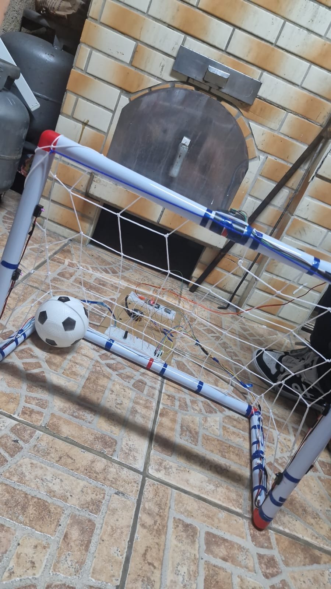
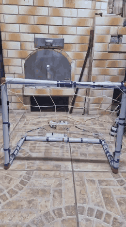
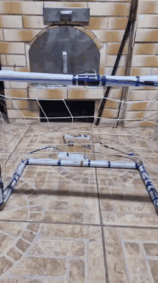
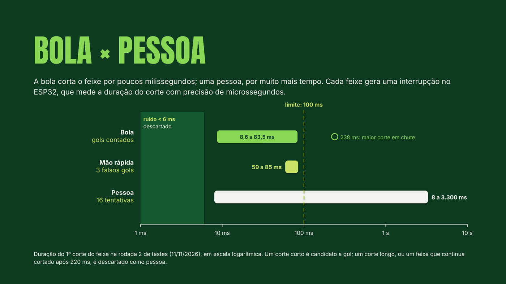
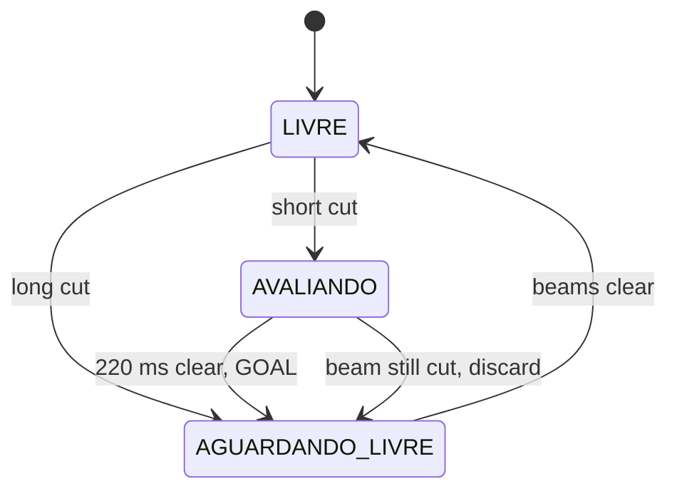
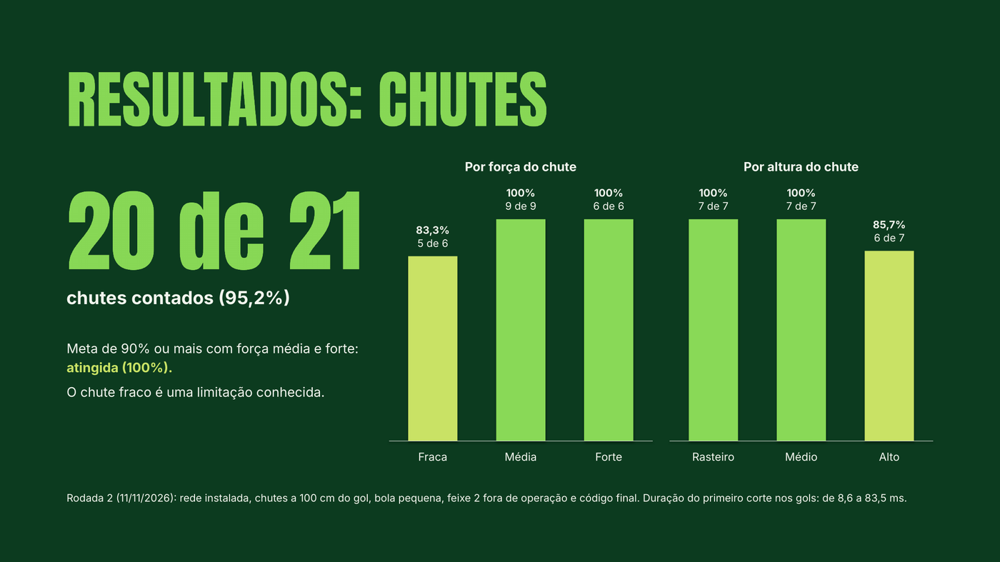

<h1 align="center">⚽ Bola na Rede</h1>

<b>The goal nobody argues about.</b>

Automatic goal detection on a small PVC goal with an ESP32: infrared beams tell the ball apart from a person, a speaker celebrates, and a live scoreboard runs in the browser.

🇧🇷 <a href="README.md">Português</a> | 🇺🇸 <b>English</b>

  
  
  

🔊 <a href="docs/media/demo-gol.mp4">Video with sound</a>

Team project for the **Cyber-Physical Systems Connectivity** course, Software Engineering, **PUCPR**, presented on Nov 12, 2026.

---

## ⚙️ How it works

The challenge isn't knowing whether something crossed the line, it's knowing **whether it was the ball**. The decision comes from **how long the beam is cut**:

- Each beam fires an interrupt on the ESP32, which measures the cut in microseconds.
- A cut of up to **100 ms** may be the ball; longer is a person and the play is discarded.
- After a short cut, the ESP32 waits **220 ms**: if no beam is still cut, it's a goal.
- A goal plays one of 3 sounds on the DFPlayer and locks out new goals for 5 s.
- The ultrasonic sensor on the crossbar calibrates the empty goal on startup and works as an extra check.

---

## 🧰 Hardware and wiring

ESP32 DevKit V1 · 3 RAD100CM infrared beams · HC-SR04 ultrasonic sensor · DFPlayer Mini with microSD and speaker · 1 kΩ and 2 kΩ resistors · power bank · 60 × 47 cm PVC goal with net.

| Component | ESP32 |
|---|---|
| IR beams at 11, 27 and 37 cm from the ground | GPIO 32, 33 and 25 |
| HC-SR04 Trig / Echo | GPIO 13 / GPIO 34 (Echo through a 1 kΩ + 2 kΩ divider) |
| DFPlayer RX | GPIO 14, through a 1 kΩ resistor |
| HC-SR04 and DFPlayer VCC | VIN (5 V), common GND |

---

## 🚀 Running it

1. Arduino IDE with the ESP32 package (**ESP32 Dev Module** board) and the **DFRobotDFPlayerMini** library.
2. Copy `firmware/BolaNaRede/secrets.example.h` to `secrets.h` and fill in your Wi-Fi (**2.4 GHz**).
3. On the microSD (FAT32), copy `0001.mp3`, `0002.mp3` and `0003.mp3` to the root, in that order.
4. Turn the Wi-Fi on before the ESP32, upload with the goal empty and open the IP shown in the Serial Monitor (115200).

The scoreboard is at `/` and the goal history at `/historico`.

---

## 📊 Results

Tests on Nov 11, 2026, with the net on, kicks from 100 cm and the presentation ball:

- **20 of 21 kicks counted (95%)**, 100% for medium and hard kicks.
- **0 false goals** in 12 attempts with a leg, foot, body or still hand.

**Limitations:** a very slow ball (under ~1.5 m/s) is treated as a person; a hand passed quickly on purpose may count as a goal; the top beam (GPIO 25) was out of order during the tests.

---

## 👥 Team

Arthur Lopes Pain · João Vitor Vicente Franco de Souza · João Pedro Muller Spielmann · Leonardo Candelorio de Nardi Ferreira · Wellington Nery Gonçalves da Costa
