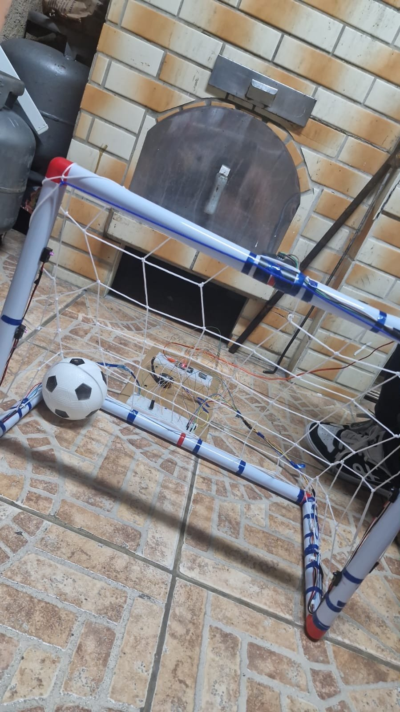
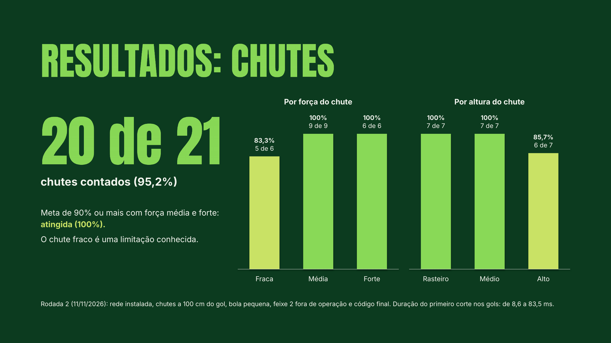

🇧🇷 <b>Português</b> | 🇺🇸 <a href="README.en.md">English</a>

---

<h1 align="center">⚽ Bola na Rede</h1>

<b>O gol que ninguém discute.</b> Um sistema de <b>detecção automática de gols</b> com <b>ESP32</b> e sensores infravermelhos, que diferencia a bola de uma pessoa, comemora o gol com som e atualiza um <b>placar ao vivo</b> no navegador.

  
  
  

🔊 <a href="docs/media/demo-gol.mp4">Ver a demonstração com som</a>

---

## 🎯 Sobre o projeto

- 🏫 Projeto em equipe da disciplina de **Conectividade de Sistemas Ciberfísicos**, Engenharia de Software na **PUCPR**, apresentado em **12/11/2026**
- ❓ **O problema:** em partidas de pequeno porte, o gol depende do olho dos jogadores e o placar é atualizado na mão, o que gera discussão, esquecimento e erro na contagem
- 💡 **A solução:** quando a bola cruza a linha, o sistema confirma o gol sozinho, toca um som e atualiza um placar que qualquer pessoa vê no celular
- 🧩 **O desafio de verdade:** não é saber se algo passou pela linha, e sim **se era a bola**. Uma perna, uma mão ou alguém parado na frente do gol também cortam os feixes

---

## ⚙️ Como funciona

A decisão vem da **duração do corte**, e não do número de feixes cortados: a bola atravessa o feixe em milissegundos, uma pessoa bloqueia por muito mais tempo.

- ⚡ Cada feixe gera uma **interrupção** na ESP32, que mede o corte com precisão de **microssegundos**
- ⏱️ Corte de até **100 ms** pode ser bola; mais longo é pessoa, e o lance é descartado
- 🧹 Cortes menores que **6 ms** são ruído e são ignorados
- ✅ Depois de um corte curto, a ESP32 espera **220 ms**: se nenhum feixe continuar cortado, é **gol**
- 🔊 O gol toca um de **3 sons** no DFPlayer e bloqueia novos gols por **5 s**
- 📡 O **ultrassônico** no travessão calibra o gol vazio ao ligar e serve de checagem extra

---

## 🛠️ Tecnologias e componentes

- 🧠 **ESP32 DevKit V1:** mede os cortes, decide entre bola e pessoa e hospeda o placar web
- 🔴 **3 barreiras infravermelhas RAD100CM:** a 11, 27 e 37 cm do chão (GPIO 32, 33 e 25)
- 📏 **Ultrassônico HC-SR04:** no travessão, a 46,4 cm do chão (Trig no GPIO 13, Echo no GPIO 34 por um divisor de 1 kΩ + 2 kΩ)
- 🎵 **DFPlayer Mini + microSD + alto-falante:** RX no GPIO 14, por um resistor de 1 kΩ
- 🔋 **Power bank:** deixa o conjunto portátil
- 🥅 **Mini trave de PVC (60 × 47 cm)** com rede

---

## 🚀 Como rodar

1. 💻 Arduino IDE com o pacote ESP32 (placa **ESP32 Dev Module**) e a biblioteca **DFRobotDFPlayerMini**
2. 🔐 Copie `firmware/BolaNaRede/secrets.example.h` para `secrets.h` e preencha o Wi-Fi (**2,4 GHz**)
3. 💾 No microSD (FAT32), grave `0001.mp3`, `0002.mp3` e `0003.mp3` na raiz, nessa ordem
4. 📶 Ligue o Wi-Fi antes da ESP32, faça o upload **com o gol vazio** e abra o IP mostrado no Monitor Serial (115200)

O placar fica em `/` e o histórico de gols em `/historico`.

---

## 📊 Resultados

Testes de **11/11/2026**, com rede, chutes a 100 cm e a bola da apresentação:

- ⚽ **20 de 21 chutes contados (95%)**, 100% com força média e forte
- 🚫 **0 falsos gols** em 12 tentativas de perna, pé, corpo ou mão parada
- 🔁 **Casos de borda:** dois chutes seguidos contam só o primeiro, bola que volta da rede conta 1 gol e mão tirando a bola depois do gol não gera gol novo
- 📈 **Evolução:** a primeira rodada contou 67% das bolas e teve falsos gols de pessoa. O ruído de um dos feixes e o rebote do sensor foram corrigidos com o filtro de 6 ms e uma pausa de 800 ms, chegando aos 95%

📋 <a href="docs/resultados.md">Tabela completa dos testes</a>

---

## ⚠️ Limitações

- 🐢 Bola muito lenta (abaixo de ~1,5 m/s) corta o feixe por mais de 100 ms e é tratada como pessoa
- ✋ Mão passada rápido de propósito corta igual à bola e pode contar como gol
- 🔧 O feixe de cima (GPIO 25) ficou fora de operação nos testes

---

## 👥 Equipe

- 👤 Arthur Lopes Pain
- 👤 João Vitor Vicente Franco de Souza
- 👤 João Pedro Muller Spielmann
- 👤 Leonardo Candelorio de Nardi Ferreira
- 👤 Wellington Nery Gonçalves da Costa
