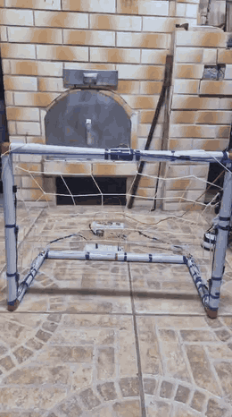
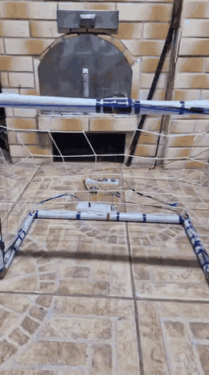
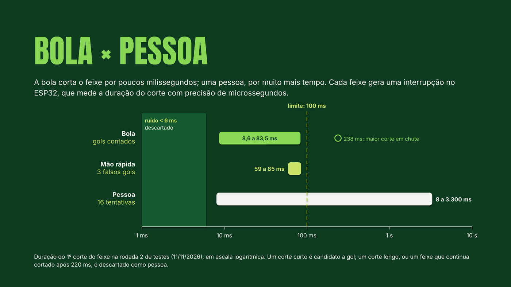
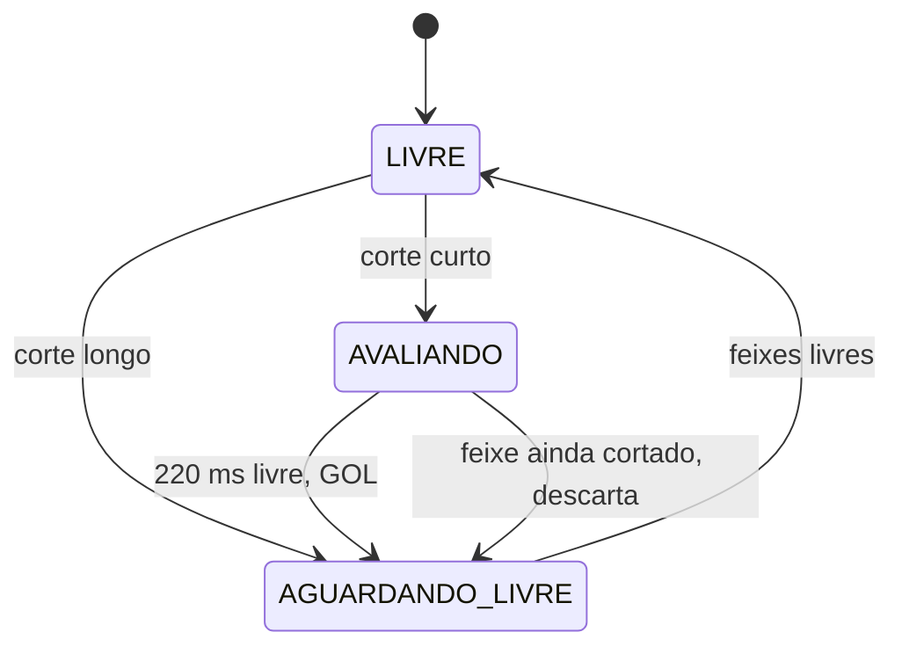

<h1 align="center">⚽ Bola na Rede</h1>

<b>O gol que ninguém discute.</b>

Detecção automática de gols numa mini trave de PVC com ESP32: barreiras infravermelhas diferenciam a bola de uma pessoa, um alto-falante comemora e um placar ao vivo roda no navegador.

🇧🇷 <b>Português</b> | 🇺🇸 <a href="README.en.md">English</a>

  
  
  

🔊 <a href="docs/media/demo-gol.mp4">Vídeo com som</a>

Projeto em equipe da disciplina de **Conectividade de Sistemas Ciberfísicos**, Engenharia de Software, **PUCPR**, apresentado em 12/11/2026.

---

## ⚙️ Como funciona

O desafio não é saber se algo passou pela linha, e sim **se era a bola**. A decisão vem da **duração do corte** do feixe:

- Cada feixe gera uma interrupção na ESP32, que mede o corte em microssegundos.
- Corte de até **100 ms** pode ser bola; mais longo é pessoa e o lance é descartado.
- Depois de um corte curto, a ESP32 espera **220 ms**: se nenhum feixe continuar cortado, é gol.
- O gol toca um de 3 sons no DFPlayer e bloqueia novos gols por 5 s.
- O ultrassônico no travessão calibra o gol vazio ao ligar e serve de checagem extra.

---

## 🧰 Hardware e ligações

ESP32 DevKit V1 · 3 barreiras infravermelhas RAD100CM · ultrassônico HC-SR04 · DFPlayer Mini com microSD e alto-falante · resistores de 1 kΩ e 2 kΩ · power bank · trave de PVC de 60 × 47 cm com rede.

| Componente | ESP32 |
|---|---|
| Feixes IR a 11, 27 e 37 cm do chão | GPIO 32, 33 e 25 |
| HC-SR04 Trig / Echo | GPIO 13 / GPIO 34 (Echo pelo divisor 1 kΩ + 2 kΩ) |
| DFPlayer RX | GPIO 14, pelo resistor de 1 kΩ |
| HC-SR04 e DFPlayer VCC | VIN (5 V), GND comum |

---

## 🚀 Como rodar

1. Arduino IDE com o pacote ESP32 (placa **ESP32 Dev Module**) e a biblioteca **DFRobotDFPlayerMini**.
2. Copie `firmware/BolaNaRede/secrets.example.h` para `secrets.h` e preencha o Wi-Fi (**2,4 GHz**).
3. No microSD (FAT32), grave `0001.mp3`, `0002.mp3` e `0003.mp3` na raiz, nessa ordem.
4. Ligue o Wi-Fi antes da ESP32, faça o upload com o gol vazio e abra o IP mostrado no Monitor Serial (115200).

O placar fica em `/` e o histórico de gols em `/historico`.

---

## 📊 Resultados

Testes de 11/11/2026, com rede, chutes a 100 cm e a bola da apresentação:

- **20 de 21 chutes contados (95%)**, 100% com força média e forte.
- **0 falsos gols** em 12 tentativas de perna, pé, corpo ou mão parada.

**Limitações:** bola muito lenta (abaixo de ~1,5 m/s) é tratada como pessoa; mão passada rápido de propósito pode contar como gol; o feixe de cima (GPIO 25) ficou fora de operação nos testes.

---

## 👥 Equipe

Arthur Lopes Pain · João Vitor Vicente Franco de Souza · João Pedro Muller Spielmann · Leonardo Candelorio de Nardi Ferreira · Wellington Nery Gonçalves da Costa
