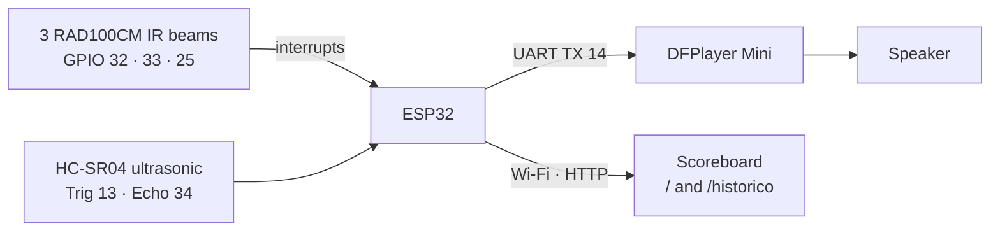
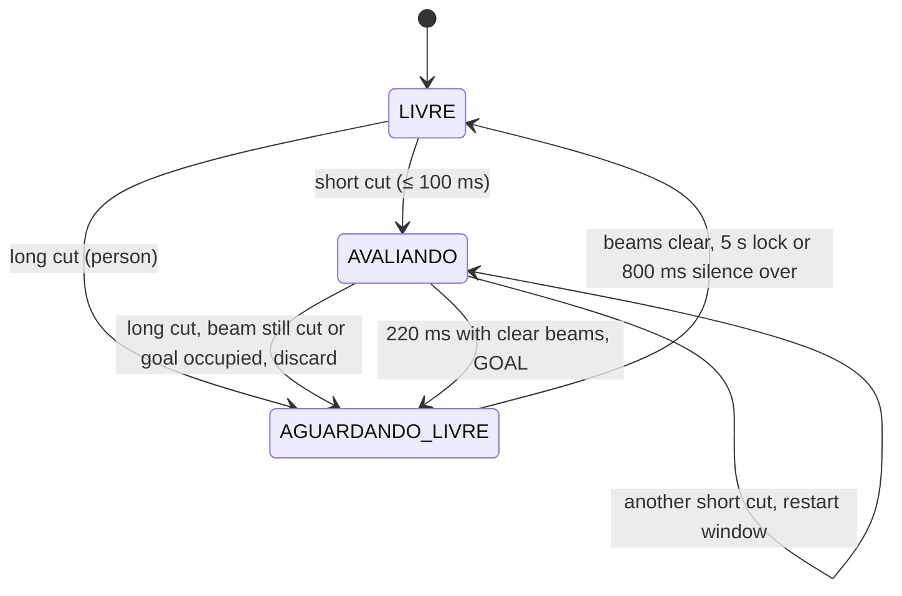
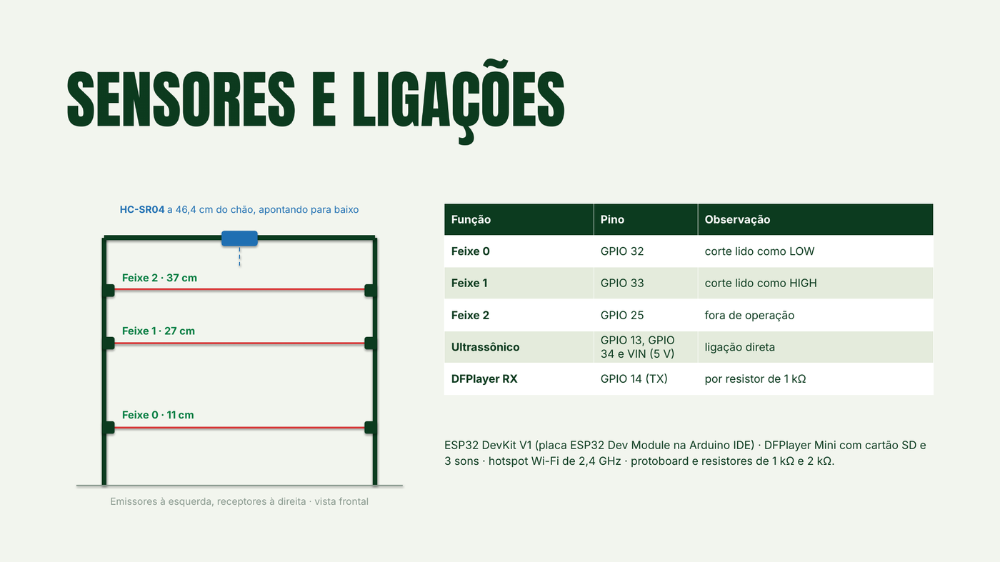
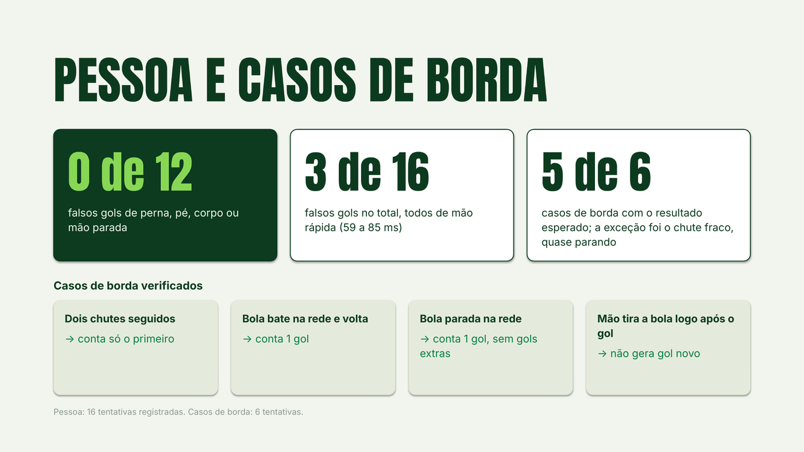

<h1 align="center">⚽ Bola na Rede</h1>

<b>The goal nobody argues about.</b>

Automatic goal detection and validation for a small PVC soccer goal, built on an ESP32. 
Infrared beams tell the ball apart from a person by <b>how long</b> the beam stays cut, a speaker celebrates the goal, and a live scoreboard runs on a web page served by the board itself.

🇺🇸 <b>English</b> | 🇧🇷 <a href="README.pt.md">Português</a>

  
  
  

🔊 <a href="docs/media/demo-gol.mp4">Demo video with sound</a> · 📊 <a href="docs/apresentacao-bola-na-rede.pdf">Final presentation (PDF, in Portuguese)</a>

---

## 📌 The problem

In casual matches, whether it was a goal depends on what the players saw, and someone has to update the score by hand after every goal, which leads to forgotten goals and counting mistakes.

**The idea:** when the ball crosses the line, the system confirms the goal on its own, plays a sound and updates a scoreboard anyone can see on their phone.

The hard part was never "did something cross the line?". It was **"was it the ball?"**. A leg, a hand or a person standing in front of the goal also cuts the beams.

> Academic team project for the **Cyber-Physical Systems Connectivity** course, Software Engineering at **PUCPR** (2nd semester). Presented on November 12, 2026.

---

## ⚙️ How it works

The decision is based on **how long the beam is cut**, not on how many beams are cut: the ball crosses a beam in a few milliseconds, a person blocks it for much longer.

1. **Infrared beams.** Each receiver fires an interrupt on the ESP32 the instant its beam is cut and released. The interrupt only stores timestamps, with microsecond precision; the decision happens in the main loop, so the web server never makes the system miss a fast ball.
2. **Noise filter.** Cuts shorter than **6 ms** are noise and are ignored. If a beam reconnects and gets cut again within **8 ms**, it's the same cut.
3. **Ball or person.** A cut of up to **100 ms** may be the ball. Longer than that is a person, and the play is discarded.
4. **Validation.** After a short cut, the ESP32 waits **220 ms** and checks whether any beam is still cut. If everything is clear, it's a goal.
5. **Celebration.** It counts the goal, plays one of 3 sounds on the DFPlayer (picked at random) and locks out new goals for **5 s**. After a person, it stays quiet for **800 ms** to ignore sensor bounce.
6. **Ultrasonic backup.** On startup it calibrates the empty-goal distance by itself (median of 20 readings). After a short cut, it can check whether the goal is empty and reinforce the discard if something is still under the crossbar.

### State machine

---

## 🧰 Hardware

| Part | Qty | Role |
|---|---|---|
| ESP32 DevKit V1 | 1 | Measures the cuts, decides ball vs. person and hosts the web scoreboard |
| RAD100CM infrared beam (emitter + receiver) | 3 | Measure the duration of each cut |
| HC-SR04 ultrasonic sensor | 1 | On the crossbar: calibrates the empty goal and checks if it's empty |
| DFPlayer Mini + microSD + speaker | 1 | Plays one of 3 sounds on each goal |
| 1 kΩ and 2 kΩ resistors | | 1 kΩ on the DFPlayer RX; 1 kΩ + 2 kΩ voltage divider on Echo |
| Protoboard and jumpers | | Wiring |
| Power bank | 1 | Makes the whole thing portable |
| Small PVC goal (60 × 47 cm) with net | 1 | The field. The net forms a right triangle with the goal mouth and the ground |

### Layout and wiring

- **Infrared beams** at **11 cm** (beam 0), **27 cm** (beam 1) and **37 cm** (beam 2) from the ground. Emitters on the left post, receivers on the right.
- **Ultrasonic sensor** in the middle of the crossbar, **46.4 cm** from the ground, pointing down.

| From | To (ESP32) | Notes |
|---|---|---|
| IR receiver, beam 0 | GPIO 32 | `INPUT_PULLUP`, cut reads LOW |
| IR receiver, beam 1 | GPIO 33 | `INPUT_PULLUP`, cut reads HIGH |
| IR receiver, beam 2 | GPIO 25 | `INPUT_PULLUP`, cut reads LOW (out of order in the final tests) |
| HC-SR04 Trig | GPIO 13 | |
| HC-SR04 Echo | GPIO 34 | Through the 1 kΩ / 2 kΩ voltage divider (Echo outputs 5 V, the ESP32 is 3.3 V) |
| HC-SR04 VCC | VIN (5 V) | |
| DFPlayer RX | GPIO 14 (TX) | Through the 1 kΩ resistor |
| DFPlayer VCC / GND | VIN / GND | Common ground for everything |
| Speaker | DFPlayer SPK_1 / SPK_2 | |

> Each IR module may read a cut as HIGH or LOW. Check yours in the Serial Monitor and adjust `IR_CORTADO_EM_HIGH` in the code.

---

## 🚀 Running it

1. **Arduino IDE** with the ESP32 boards package; select the **ESP32 Dev Module** board.
2. Install the **DFRobotDFPlayerMini** library (Library Manager). `WiFi` and `WebServer` come with the ESP32 package.
3. Copy `firmware/BolaNaRede/secrets.example.h` to `secrets.h` in the same folder and fill in your network name and password (**2.4 GHz only**; a phone hotspot works). `secrets.h` is in `.gitignore`.
4. Prepare the microSD card: see [`sd-card/`](sd-card/README.md).
5. Open `firmware/BolaNaRede/BolaNaRede.ino` and upload. If compilation fails with a path error, move the project to a short folder path with no accents.
6. **Turn the Wi-Fi on before the ESP32**: the code only continues once it connects.
7. **Keep the goal empty** while it boots: the ultrasonic sensor calibrates at startup.
8. Open the Serial Monitor at **115200 baud**, grab the IP and open it in a browser on any device on the same network.

### Web scoreboard and API

| Route | What it shows |
|---|---|
| `/` | Scoreboard with a "GOOOL!" animation and whistle, sensor status and time since the last goal |
| `/historico` | The last 100 goals, with times |
| `/dados` | JSON: sensor status, count and time since the last goal |
| `/gols` | JSON with the history |
| `/zerar` | Resets the scoreboard |

The ESP32 has no real-time clock: goals are stored with `millis()`, and the history page converts them to real time using the clock of the device viewing it.

---

## 🎛️ Parameters

| Constant | Value in code | What it does | When to change it |
|---|---|---|---|
| `DURACAO_BOLA_MS` | 100 | Ball vs. person threshold | Raise (e.g. 130) for a bigger ball; lower if a hand counts as a goal |
| `MIN_PULSO_US` | 6000 | Shorter cuts are noise | Lower to 4000 if a hard kick doesn't count |
| `GAP_UNIAO_US` | 8000 | Reconnects shorter than this = same cut | Rarely |
| `AVALIACAO_MS` | 220 | Wait before confirming | Rarely |
| `ESPERA_US_MS` | 80 | Wait before using ultrasonic readings | Rarely |
| `SILENCIO_MS` | 800 | Pause after a person or a discard | Raise if a person leaving still causes a false goal |
| `BLOQUEIO_MS` | 5000 | Lock after a goal | Match your longest sound |
| `USAR_US_NO_VETO` | `false` | Ultrasonic as an extra check | `true` to let it discard plays |
| `MODO_CALIBRACAO` / `DEBUG_US` | `true` | Log every cut and reading to Serial | `true` while testing, `false` for demos |

---

## 📊 Results

Test round 2 (Nov 11, 2026): net installed, kicks from 100 cm, small ball, beam 2 out of order, final code.

| Test | Result |
|---|---|
| Kicks | **20 of 21 counted (95.2%)**. Medium and hard kicks: 100%. The miss was a weak kick |
| Leg, foot, body or still hand | **0 false goals in 12 attempts** |
| Person, overall | 3 false goals in 16 attempts, all from a fast hand (59 to 85 ms) |
| Edge cases | 5 of 6 with the expected result |
| Cut duration on goals | 8.6 to 83.5 ms |

**Edge cases checked:** two kicks in a row count only the first; a ball that hits the net and bounces back counts 1 goal; a ball resting in the net counts 1 goal with no extras; a hand taking the ball out right after a goal doesn't create a new one.

**Progress:** in round 1 (old code, ball thrown by hand), 18 of 27 balls were counted (67%) and there were 6 false goals in 21 person attempts. The causes, noise on beam 1 and sensor bounce as a person walked away, were fixed with the noise filter and the 800 ms silence. The rounds aren't directly comparable (thrown ball vs. kick).

---

## ⚠️ Limitations

- **Very slow ball:** a cut longer than 100 ms is treated as a person. Below ~1.5 m/s (15 cm ball) to ~2.1 m/s (21 cm ball), the goal doesn't count.
- **Deliberately fast hand:** it cuts the beam for 59 to 85 ms, the ball for 8 to 83 ms. These sensors can't tell them apart.
- **Beam 2 out of order:** hardware failure; the top of the goal has less coverage.
- **Noise filter margin:** the shortest ball cut was 8.6 ms and the filter is 6 ms; a very hard kick might be missed.
- **Ultrasonic area:** the HC-SR04 only sees the region under the middle of the crossbar, in a cone of about 15°.
- **Calibrated for the ball used:** validated with the presentation ball, kicked from 100 cm. A different setup needs recalibration.
- **Memory only:** the score and history live in RAM and reset when the ESP32 restarts.

## 🔭 Next steps

The project is complete. For a professional follow-up:

1. Reliably tell the ball apart from a human (e.g. with a camera).
2. Detect slow balls.
3. Take the system to a real, full-size goal.

---

## 👥 Team

- Arthur Lopes Pain
- João Pedro Muller Spielmann
- João Vitor Vicente
- Leonardo Nardi Ferreira
- Wellington Nery Gonçalves da Costa
