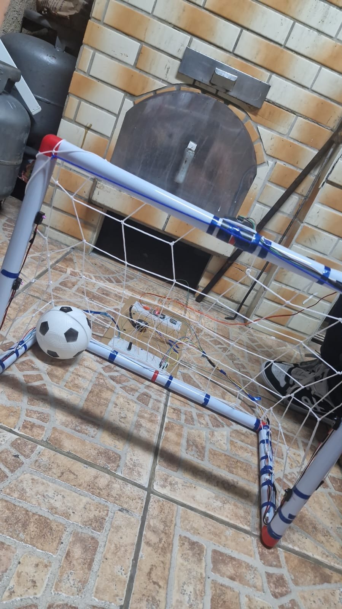
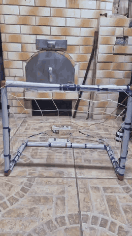
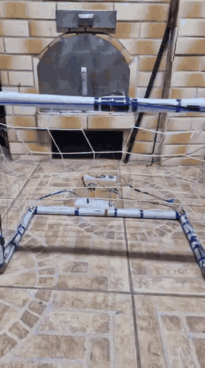
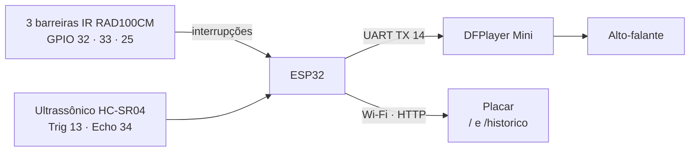
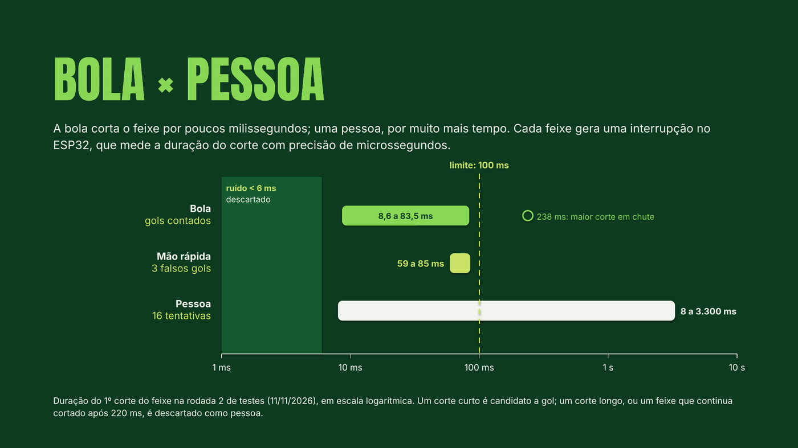
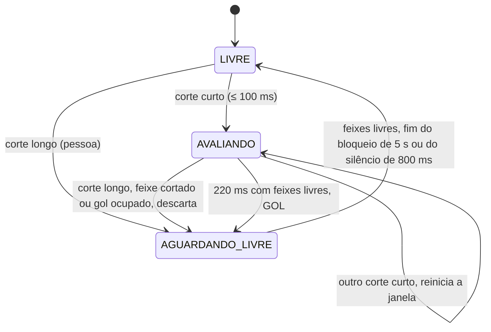
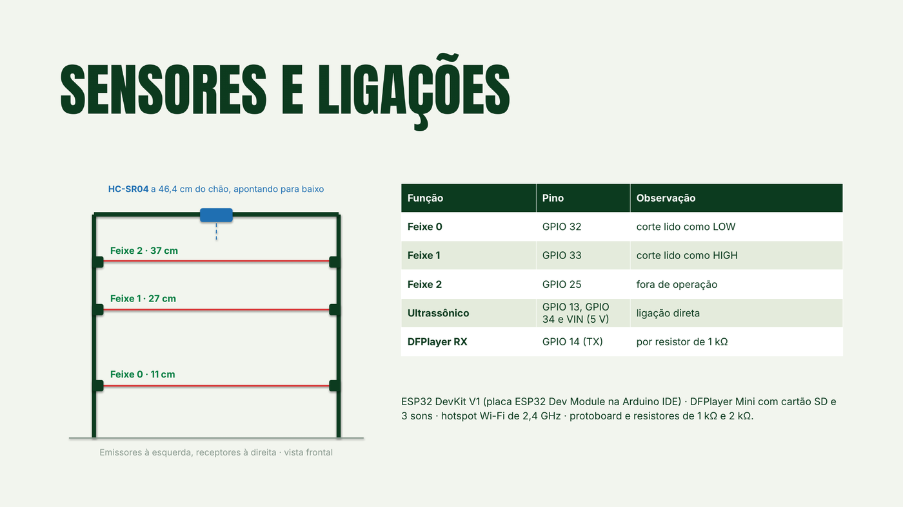
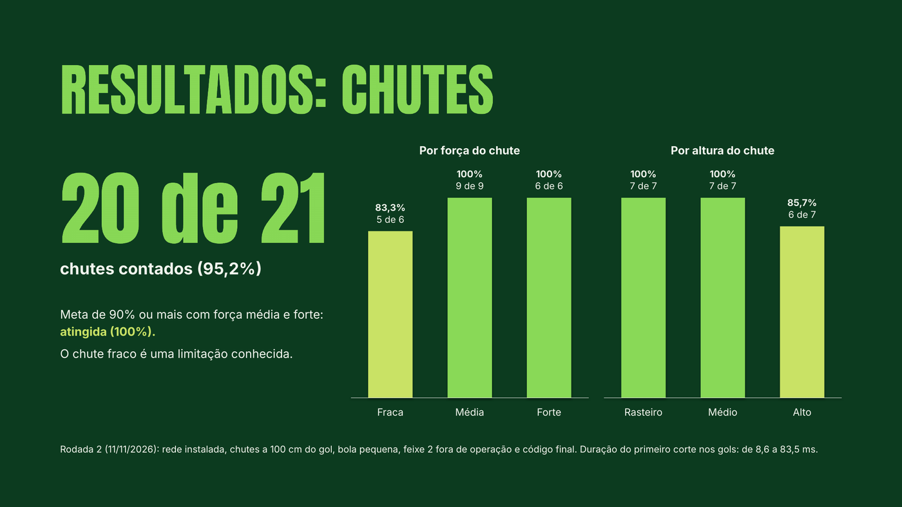
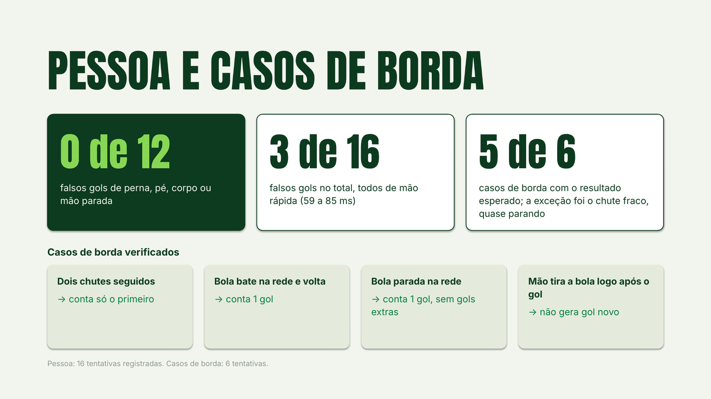

<h1 align="center">⚽ Bola na Rede</h1>

<b>O gol que ninguém discute.</b>

Sistema de detecção e validação automática de gols numa mini trave de PVC, feito com ESP32. 
Barreiras infravermelhas diferenciam a bola de uma pessoa pelo <b>tempo</b> que o feixe fica cortado, um alto-falante comemora o gol e um placar ao vivo roda numa página web servida pela própria placa.

🇺🇸 <a href="README.md">English</a> | 🇧🇷 <b>Português</b>

  
  
  

🔊 <a href="docs/media/demo-gol.mp4">Vídeo da demonstração com som</a> · 📊 <a href="docs/apresentacao-bola-na-rede.pdf">Apresentação final (PDF)</a>

---

## 📌 O problema

Em partidas de pequeno porte, a validação do gol depende da observação dos próprios jogadores, e o placar é alterado manualmente a cada gol, o que exige atenção de alguém e gera esquecimentos e erros na contagem.

**Proposta:** quando a bola cruza a linha, o sistema confirma o gol sozinho, toca um som e atualiza um placar que qualquer pessoa vê no celular.

A parte difícil nunca foi "passou alguma coisa pela linha?". Foi **"era a bola?"**. Uma perna, uma mão ou uma pessoa parada na frente do gol também cortam os feixes.

> Projeto acadêmico em equipe da disciplina de **Conectividade de Sistemas Ciberfísicos**, Engenharia de Software na **PUCPR** (2º período). Apresentado em 12 de novembro de 2026.

---

## ⚙️ Como funciona

A decisão se baseia na **duração do corte**, e não no número de feixes cortados: a bola atravessa o feixe em poucos milissegundos, uma pessoa bloqueia por muito mais tempo.

1. **Feixes infravermelhos.** Cada receptor dispara uma interrupção no ESP32 no instante em que o feixe é cortado e liberado. A interrupção só guarda os tempos, com precisão de microssegundos; a decisão fica no loop principal, então o servidor web nunca faz o sistema perder uma bola rápida.
2. **Filtro de ruído.** Cortes menores que **6 ms** são ruído e são ignorados. Se o feixe religa e corta de novo em menos de **8 ms**, conta como o mesmo corte.
3. **Bola ou pessoa.** Corte de até **100 ms**: pode ser a bola. Acima disso: é uma pessoa, e o lance é descartado.
4. **Validação.** Depois de um corte curto, o ESP32 espera **220 ms** e confere se algum feixe continua cortado. Se estiver tudo livre, é gol.
5. **Comemoração.** Conta o gol, toca um dos 3 sons do DFPlayer (sorteado) e bloqueia novos gols por **5 s**. Depois de uma pessoa, fica em silêncio por **800 ms** para ignorar o rebote do sensor.
6. **Apoio do ultrassônico.** Ao ligar, calibra sozinho a distância do gol vazio (mediana de 20 leituras). Depois de um corte curto, pode conferir se o gol ficou vazio e reforçar o descarte se ainda houver algo sob o travessão.

### Máquina de estados

---

## 🧰 Hardware

| Peça | Qtd | Função |
|---|---|---|
| ESP32 DevKit V1 | 1 | Mede os cortes, decide entre bola e pessoa e hospeda o placar web |
| Barreira infravermelha RAD100CM (emissor + receptor) | 3 | Medem a duração de cada corte |
| Sensor ultrassônico HC-SR04 | 1 | No travessão: calibra o gol vazio e confere se ele ficou vazio |
| DFPlayer Mini + cartão microSD + alto-falante | 1 | Toca um dos 3 sons a cada gol |
| Resistores de 1 kΩ e 2 kΩ | | 1 kΩ no RX do DFPlayer; 1 kΩ + 2 kΩ como divisor de tensão no Echo |
| Protoboard e jumpers | | Ligações |
| Power bank | 1 | Deixa o conjunto portátil |
| Mini trave de PVC (60 × 47 cm) com rede | 1 | O campo. A rede forma um triângulo retângulo com a entrada do gol e o chão |

### Montagem e ligações

- **Feixes infravermelhos** a **11 cm** (feixe 0), **27 cm** (feixe 1) e **37 cm** (feixe 2) do chão. Emissores na trave esquerda, receptores na direita.
- **Ultrassônico** no meio do travessão, a **46,4 cm** do chão, apontado para baixo.

| De | Para (ESP32) | Observações |
|---|---|---|
| Receptor IR, feixe 0 | GPIO 32 | `INPUT_PULLUP`, corte lido como LOW |
| Receptor IR, feixe 1 | GPIO 33 | `INPUT_PULLUP`, corte lido como HIGH |
| Receptor IR, feixe 2 | GPIO 25 | `INPUT_PULLUP`, corte lido como LOW (fora de operação nos testes finais) |
| HC-SR04 Trig | GPIO 13 | |
| HC-SR04 Echo | GPIO 34 | Pelo divisor de tensão 1 kΩ / 2 kΩ (o Echo sai em 5 V e a ESP32 é 3,3 V) |
| HC-SR04 VCC | VIN (5 V) | |
| DFPlayer RX | GPIO 14 (TX) | Pelo resistor de 1 kΩ |
| DFPlayer VCC / GND | VIN / GND | GND comum a tudo |
| Alto-falante | DFPlayer SPK_1 / SPK_2 | |

> Cada módulo IR pode ler o corte como HIGH ou LOW. Confira o seu no Monitor Serial e ajuste `IR_CORTADO_EM_HIGH` no código.

---

## 🚀 Como rodar

1. **Arduino IDE** com o pacote de placas ESP32; selecione a placa **ESP32 Dev Module**.
2. Instale a biblioteca **DFRobotDFPlayerMini** (Gerenciador de Bibliotecas). `WiFi` e `WebServer` já vêm com o pacote da ESP32.
3. Copie `firmware/BolaNaRede/secrets.example.h` para `secrets.h` na mesma pasta e preencha nome e senha da rede (**só 2,4 GHz**; um hotspot de celular funciona). O `secrets.h` está no `.gitignore`.
4. Prepare o cartão microSD: veja [`sd-card/`](sd-card/README.md).
5. Abra `firmware/BolaNaRede/BolaNaRede.ino` e faça o upload. Se der erro de caminho na compilação, salve o projeto numa pasta curta e sem acento.
6. **Ligue o Wi-Fi antes da ESP32**: o código só segue depois de conectar.
7. **Deixe o gol vazio** enquanto liga: o ultrassônico calibra na inicialização.
8. Abra o Monitor Serial em **115200 baud**, pegue o IP e abra no navegador de qualquer aparelho na mesma rede.

### Placar web e API

| Rota | O que mostra |
|---|---|
| `/` | Placar com animação "GOOOL!" e apito, estado do sensor e tempo desde o último gol |
| `/historico` | Últimos 100 gols, com horário |
| `/dados` | JSON: estado do sensor, contagem e tempo desde o último gol |
| `/gols` | JSON com o histórico |
| `/zerar` | Zera o placar |

A ESP32 não tem relógio de tempo real: os gols são guardados com `millis()` e a página de histórico converte para o horário real usando o relógio do aparelho que está vendo.

---

## 🎛️ Parâmetros

| Constante | Valor no código | O que faz | Quando mexer |
|---|---|---|---|
| `DURACAO_BOLA_MS` | 100 | Limite entre bola e pessoa | Subir (ex.: 130) com bola maior; descer se uma mão virar gol |
| `MIN_PULSO_US` | 6000 | Corte menor que isso é ruído | Reduzir para 4000 se um chute forte não contar |
| `GAP_UNIAO_US` | 8000 | Religou antes disso = mesmo corte | Raramente |
| `AVALIACAO_MS` | 220 | Espera antes de confirmar | Raramente |
| `ESPERA_US_MS` | 80 | Espera antes de usar as leituras do ultrassônico | Raramente |
| `SILENCIO_MS` | 800 | Pausa depois de pessoa ou descarte | Subir se ainda houver gol falso na saída de uma pessoa |
| `BLOQUEIO_MS` | 5000 | Bloqueio depois do gol | Igualar ao som mais longo |
| `USAR_US_NO_VETO` | `false` | Ultrassônico como checagem extra | `true` para ele poder descartar lances |
| `MODO_CALIBRACAO` / `DEBUG_US` | `true` | Log de cada corte e leitura no Serial | `true` nos testes, `false` na demonstração |

---

## 📊 Resultados

Rodada 2 de testes (11/11/2026): rede instalada, chutes a 100 cm do gol, bola pequena, feixe 2 fora de operação e código final.

| Teste | Resultado |
|---|---|
| Chutes | **20 de 21 contados (95,2%)**. Força média e forte: 100%. A falha foi um chute fraco |
| Perna, pé, corpo ou mão parada | **0 falsos gols em 12 tentativas** |
| Pessoa, no total | 3 falsos gols em 16 tentativas, todos de mão rápida (59 a 85 ms) |
| Casos de borda | 5 de 6 com o resultado esperado |
| Duração do corte nos gols | 8,6 a 83,5 ms |

**Casos de borda verificados:** dois chutes seguidos contam só o primeiro; bola que bate na rede e volta conta 1 gol; bola parada na rede conta 1 gol, sem gols extras; mão tirando a bola logo após o gol não gera gol novo.

**Evolução:** na rodada 1 (código antigo, bola lançada à mão), 18 de 27 bolas foram contadas (67%) e houve 6 falsos gols em 21 tentativas de pessoa. As causas, ruído do feixe 1 e rebote do sensor quando a pessoa saía, foram corrigidas com o filtro de ruído e o silêncio de 800 ms. As rodadas não são diretamente comparáveis (bola lançada à mão × chute).

---

## ⚠️ Limitações

- **Bola muito lenta:** um corte acima de 100 ms é tratado como pessoa. Abaixo de ~1,5 m/s (bola de 15 cm) a ~2,1 m/s (bola de 21 cm), o gol não conta.
- **Mão rápida de propósito:** corta o feixe por 59 a 85 ms, e a bola por 8 a 83 ms. Esses sensores não separam as duas.
- **Feixe 2 fora de operação:** falha de hardware; o topo do gol tem cobertura menor.
- **Margem do filtro de ruído:** o corte mais curto da bola foi de 8,6 ms e o filtro é de 6 ms; um chute muito forte pode falhar.
- **Área do ultrassônico:** o HC-SR04 mede só a região sob o centro do travessão, num cone de cerca de 15°.
- **Calibrado para a bola usada:** validado com a bola da apresentação, a 100 cm do gol. Outro cenário exige nova calibração.
- **Só na memória:** placar e histórico ficam na RAM e zeram quando a ESP32 reinicia.

## 🔭 Próximos passos

O projeto está concluído. Para uma continuação profissional:

1. Separar a bola de um ser humano de forma confiável (por exemplo, com câmera).
2. Identificar bolas lentas.
3. Levar o sistema para um gol de verdade, em tamanho oficial.

---

## 👥 Equipe

- Arthur Lopes Pain
- João Pedro Muller Spielmann
- João Vitor Vicente
- Leonardo Nardi Ferreira
- Wellington Nery Gonçalves da Costa
